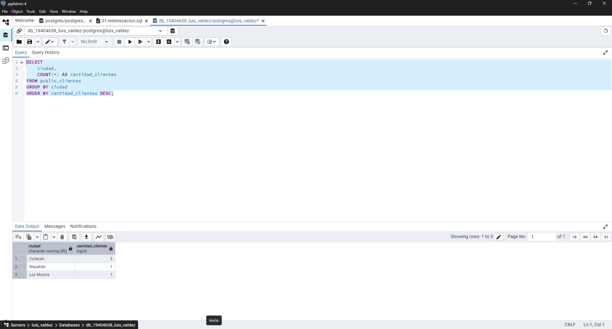
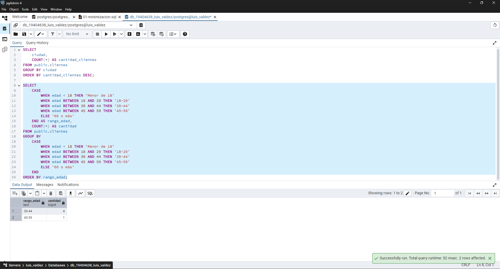
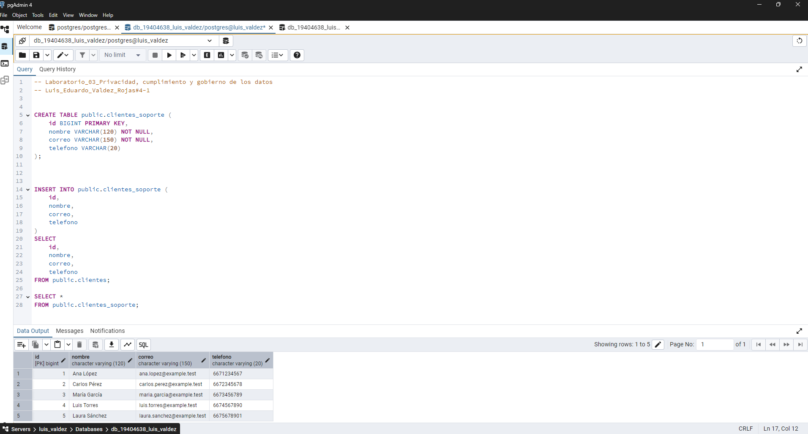
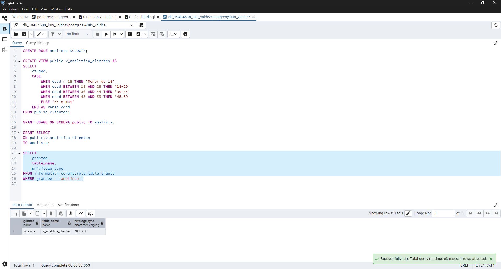
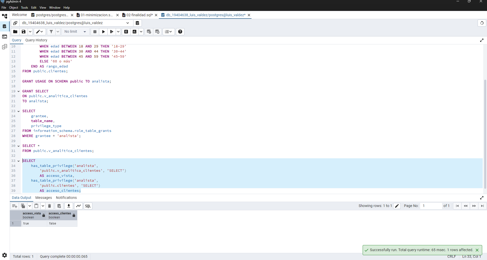
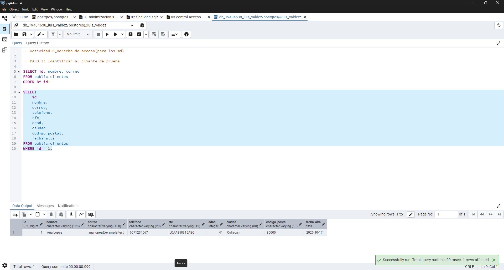
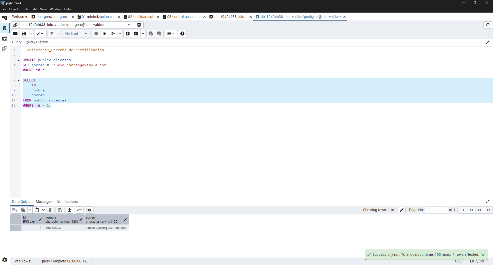

# dba-19706-2026-2-ValdezRojas-LuisEduardo-
PracticasDBA

# LAB-03: Privacidad, cumplimiento y gobierno de los datos

# UNIVERSIDAD AUTÓNOMA DE SINALOA
# FACULTAD DE INFORMÁTICA CULIACÁN

# UNIVERSIDAD AUTÓNOMA DE SINALOA
## FACULTAD DE INFORMÁTICA CULIACÁN

**ASIGNATURA:**

Comercio electrónico

**MAESTRO:**

Dra. Jimenez Bernal

**ALUMNO:**

Valdez Rojas Luis Eduardo

**GRUPO:**

3-1

**FECHA:**

19/10/2026

## 1. Introducción

En este laboratorio trabajamos con una base de datos de clientes de una empresa ficticia llamada Comercializadora Norte. La idea fue aprender a proteger la información personal y entender que no todos los datos deben estar disponibles para cualquier empleado.

Utilizamos PostgreSQL para realizar consultas, crear tablas con información limitada y establecer permisos. También analizamos situaciones relacionadas con el uso, modificación y eliminación de los datos.

## 2. Inventario de datos

La tabla `clientes` contiene nueve campos: id, nombre, correo, teléfono, RFC, edad, ciudad, código postal y fecha de alta.

Identificamos que estos datos pueden relacionarse con una persona, pero no todos se necesitan para las mismas actividades.

| Tipo de información | Datos |
|---|---|
| Identificación | id, nombre |
| Contacto | correo, teléfono |
| Fiscal | RFC |
| Estadísticas y ubicación | edad, ciudad, código postal |
| Registro | fecha de alta |

El inventario completo se encuentra en `evidencias/01-inventario-datos.md`.

## 3. Finalidades

Los datos deben utilizarse dependiendo de las necesidades de cada área.

- **Soporte:** necesita nombre, correo y teléfono para atender a los clientes.
- **Facturación:** necesita nombre, RFC y los datos fiscales correspondientes.
- **Analítica:** necesita información general para realizar estadísticas, sin identificar a cada cliente.

En la Actividad 3 realizamos consultas para agrupar clientes por ciudad y rango de edad, sin mostrar información como nombres, correos o RFC.

También analizamos el uso de datos para promociones. Concluimos que la empresa debe revisar si esa finalidad está permitida antes de utilizar la información.

## 4. Minimización

En esta actividad creamos la tabla `clientes_soporte`, utilizando únicamente cuatro campos:

- id
- nombre
- correo
- teléfono

Después copiamos los cinco registros de la tabla original y comprobamos que aparecieran correctamente.

No incluimos RFC, edad, ciudad ni código postal porque no eran necesarios para la atención general del cliente.

Con esto aprendimos que no siempre es necesario copiar toda la información de una tabla para realizar una tarea.

El código utilizado está en `sql/01-minimizacion.sql`.

## 5. Control de acceso

Creamos un rol llamado `analista` y una vista llamada `v_analitica_clientes`.

Esta vista permite consultar ciudad y rango de edad sin mostrar directamente los datos de identificación de los clientes.

Después utilizamos `GRANT` para permitir que el rol consultara la vista.

Al verificar los permisos, comprobamos que el rol tenía acceso a la vista, pero no directamente a la tabla original `clientes`.

Esto nos permitió aplicar el principio de mínimo privilegio, que consiste en dar solamente los permisos necesarios.

El código está en `sql/03-control-acceso.sql`.

## 6. Derechos ARCO

Los derechos ARCO permiten a las personas solicitar acceso, rectificación, cancelación u oposición respecto al uso de sus datos personales.

### Actividad 6 - Derecho de acceso

Utilizamos una consulta `SELECT` para localizar los datos del cliente con `id = 1`.

La consulta nos permitió revisar la información almacenada, aunque para atender una solicitud real también sería necesario comprobar la identidad del solicitante e informar sobre el uso de sus datos.

### Actividad 7 - Derecho de rectificación

Utilizamos `UPDATE` para modificar el correo del cliente con `id = 1`.

Después ejecutamos un `SELECT` para comprobar que el cambio se hubiera realizado correctamente.

En una situación real, sería necesario verificar que el cambio fue autorizado, registrar quién lo realizó y conservar evidencia de la modificación.

### Actividad 8 - Derecho de cancelación

Analizamos que eliminar un registro no significa que desaparezcan automáticamente todas sus copias.

La información también podría encontrarse en respaldos, reportes, tablas relacionadas o archivos exportados.

Por eso primero se debe revisar dónde se encuentran los datos y si existe alguna razón para conservarlos.

### Actividad 9 - Derecho de oposición

Si un cliente solicita que sus datos ya no sean utilizados para promociones, no significa que debamos eliminar inmediatamente toda su información.

1. **¿Qué información podría mantenerse?** Los datos necesarios para atender al cliente, realizar facturas o cumplir obligaciones aplicables.
2. **¿Qué información dejaría de utilizarse?** Su correo y otros datos utilizados específicamente para enviar promociones.
3. **¿Qué mecanismos técnicos podrían utilizarse?** Permisos, vistas limitadas y un registro que indique qué clientes no desean recibir promociones.
4. **¿Por qué no debe decidirlo únicamente el DBA?** Porque también intervienen cuestiones de privacidad y obligaciones legales. El DBA se encarga principalmente de aplicar las medidas técnicas que correspondan.

## 7. Retención

Analizamos que conservar todos los datos indefinidamente puede generar problemas de privacidad.

La empresa debería establecer cuánto tiempo necesita cada dato, tomando en cuenta su finalidad y las obligaciones que correspondan.

Por ejemplo, la información de contacto podría eliminarse cuando ya no sea necesaria, mientras que ciertos datos fiscales podrían requerir un periodo de conservación diferente.

La propuesta se encuentra en `evidencias/10-retencion.md`.

## 8. Gobierno de datos

En esta parte organizamos quién debería ser responsable de los datos y qué empleados pueden utilizarlos.

La matriz completa está en `evidencias/11-gobierno-datos.md`.

| Área | Datos que necesita |
|---|---|
| Soporte | Nombre, correo y teléfono |
| Facturación | Nombre y RFC |
| Analítica | Edad y ciudad para estadísticas |
| DBA | Acceso técnico según sus responsabilidades |

### Actividad 13 - Controles técnicos y administrativos

Clasificamos las medidas de seguridad de la siguiente manera:

| Medida | Técnico | Administrativo |
|---|---|---|
| Crear roles de PostgreSQL | Sí | No |
| Política de retención | No | Sí |
| Cifrado de datos | Sí | No |
| Procedimiento para solicitudes ARCO | No | Sí |
| Vista con información limitada | Sí | No |
| Clasificación de información | No | Sí |
| Registro de auditoría | Sí | No |
| Política de control de acceso | No | Sí |

Algunas medidas pueden combinar ambos tipos de control. Por ejemplo, una política de acceso es administrativa, pero para aplicarla se pueden utilizar roles y permisos de PostgreSQL. Lo mismo ocurre con la auditoría, que necesita registros técnicos y reglas para revisarlos.

## 9. Evaluación integral

En la Actividad 14 analizamos un escenario donde una empresa tenía varios problemas con la protección de sus datos.

Identificamos diez riesgos, entre ellos:

- Analistas con acceso a información personal que no necesitan.
- Datos guardados durante demasiado tiempo.
- Copias completas entregadas a desarrollo.
- Uso de información real para pruebas.
- Correos utilizados para promociones sin revisar la finalidad.

Como solución propusimos limitar permisos, utilizar datos ficticios para pruebas, establecer periodos de retención y revisar qué información necesita cada departamento.

La matriz completa está en `evidencias/14-evaluacion-integral.md`.

También realizamos una propuesta de arquitectura para separar operación, analítica y auditoría en `evidencias/15-arquitectura.md`.

## 10. Conclusiones

Con este laboratorio aprendí que proteger una base de datos no consiste solamente en colocar contraseñas o restringir usuarios. También es importante revisar qué información estamos guardando, para qué se necesita y quién debería utilizarla.

Las actividades con PostgreSQL me ayudaron a entender cómo podemos limitar los datos mediante tablas, vistas y permisos.

También comprendí que eliminar o modificar información requiere más cuidado del que parece, porque pueden existir copias o responsabilidades que deben tomarse en cuenta.

## 11. Preguntas de reflexión

### 1. ¿Una base de datos técnicamente segura necesariamente cumple con todos los requisitos de privacidad?

No, porque aunque tenga contraseñas y permisos, podría estar guardando información innecesaria o utilizándola para algo que no fue autorizado.

### 2. ¿Por qué el principio de mínimo privilegio también contribuye a la privacidad?

Porque evita que los empleados puedan consultar datos que no necesitan para realizar su trabajo.

### 3. ¿Por qué el DBA no debería decidir por sí solo la finalidad del tratamiento de los datos?

Porque el DBA administra la parte técnica, pero las decisiones sobre el uso de los datos también corresponden a los responsables de privacidad y otras áreas de la empresa.

### 4. ¿Por qué los desarrolladores no deberían recibir automáticamente copias completas de bases de datos productivas?

Porque podrían recibir información personal que no necesitan para desarrollar o probar una aplicación.

### 5. ¿Por qué una copia utilizada para desarrollo también puede representar un riesgo de privacidad?

Porque sigue teniendo información de personas reales y podría quedar expuesta si no se protege correctamente.

### 6. ¿Por qué la retención debe formar parte del ciclo de vida de los datos?

Porque es necesario saber cuánto tiempo debemos guardar la información y qué hacer cuando ya no se necesita.

### 7. ¿Qué relación existe entre privacidad por diseño y diseño de bases de datos?

Que desde que creamos una base de datos debemos pensar qué campos son necesarios y cómo vamos a protegerlos, en lugar de intentar solucionar todo después.

### 8. ¿Qué controles técnicos implementarías para reducir el riesgo de exposición de datos personales?

Utilizaría roles, permisos, vistas con información limitada, cifrado y registros de auditoría.

### 9. ¿Qué información debería conocer un DBA para responder técnicamente a una solicitud ARCO?

Debería saber dónde se encuentran los datos, qué tablas los contienen, si existen copias y qué cambios deben realizarse después de que la solicitud sea autorizada.

### 10. ¿Qué responsabilidades deberían corresponder al DBA, al responsable de privacidad, al área jurídica y al propietario de los datos?

- **DBA:** administrar la base de datos y aplicar los controles técnicos.
- **Responsable de privacidad:** revisar que los datos se utilicen correctamente.
- **Área jurídica:** revisar las obligaciones legales.
- **Propietario de los datos:** decidir cómo deben utilizarse los datos bajo su responsabilidad.

[def]: ./03-clientes-ciudad.png