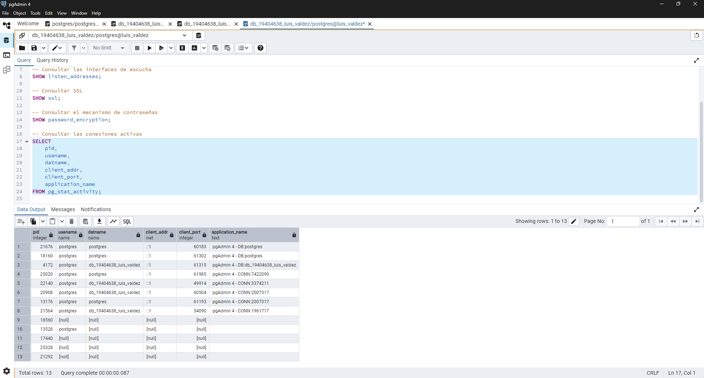
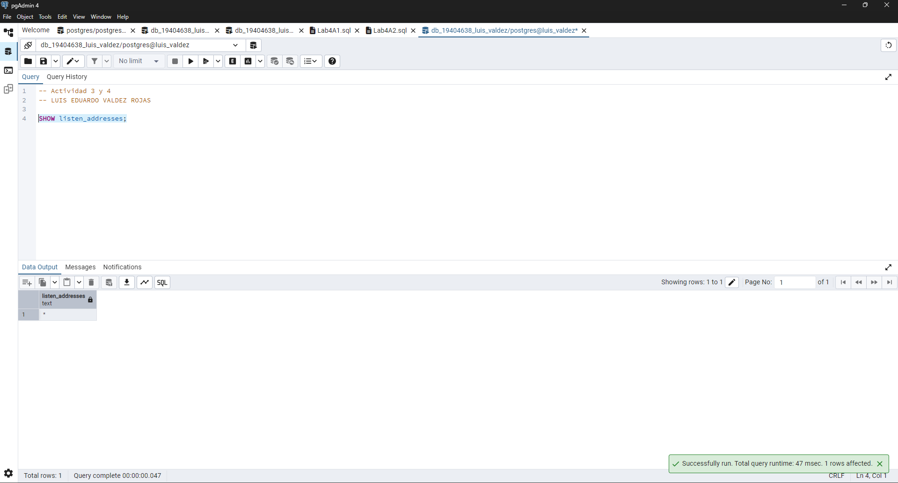
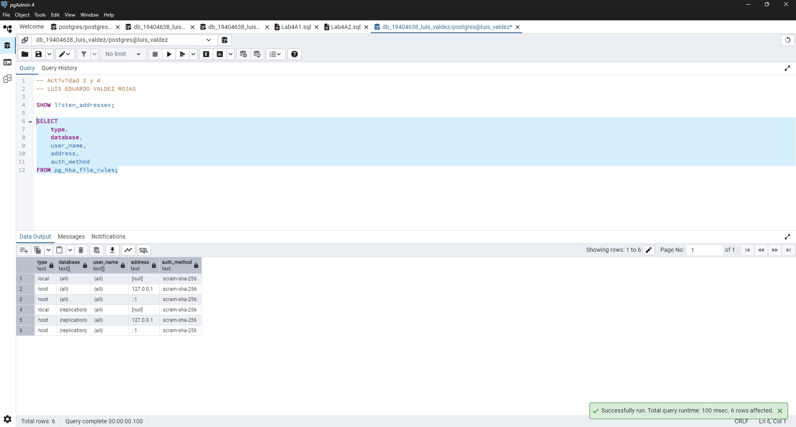
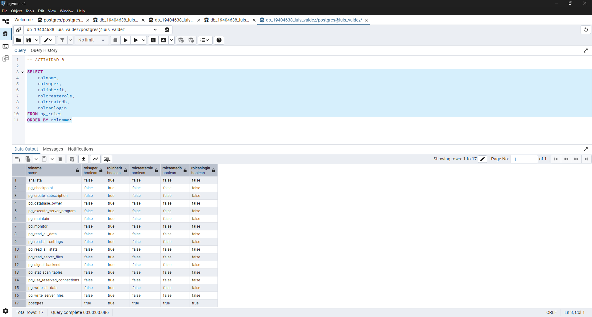
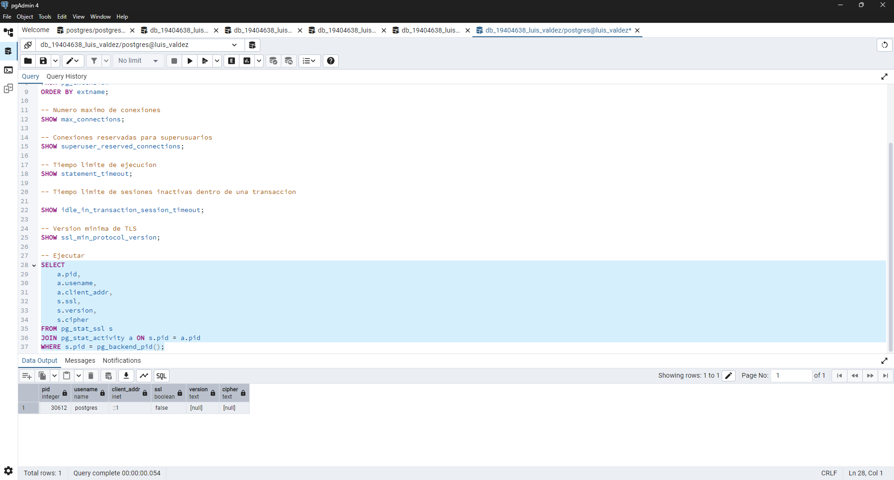
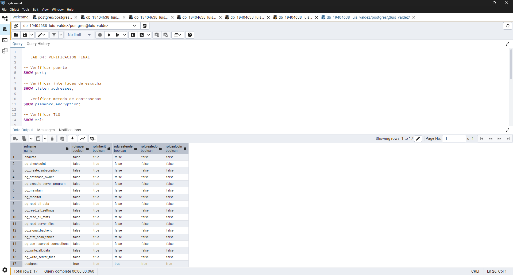

# Laboratorio 4 — Hardening y configuración segura de PostgreSQL

## Datos generales

- **Materia:** Administración de Bases de Datos
- **Unidad:** II
- **Laboratorio:** 04 — Hardening y configuración segura
- **Estudiante:** Valdez Rojas Luis Eduardo

## Introducción

En este laboratorio revisamos algunas configuraciones de seguridad de PostgreSQL para identificar posibles riesgos y conocer cómo podemos mejorar la protección de una base de datos.

Para realizar las actividades utilizamos PostgreSQL 17.4, pgAdmin 4, Visual Studio Code y una terminal de Linux mediante WSL. Primero ejecutamos consultas para conocer la configuración del servidor y después analizamos los resultados para proponer algunas mejoras de seguridad.

## Actividades realizadas

### 1. Inspección de PostgreSQL

Primero consultamos la versión de PostgreSQL, el puerto, las interfaces de escucha, el uso de SSL y el método de cifrado de contraseñas.

Obtuvimos los siguientes resultados:

| Configuración | Resultado |
|---|---|
| Versión | PostgreSQL 17.4 |
| Puerto | `5432` |
| `listen_addresses` | `*` |
| SSL | `off` |
| `password_encryption` | `scram-sha-256` |

También revisamos las conexiones activas y las rutas de los archivos de configuración.

### 2. Revisión de interfaces y reglas de acceso

Consultamos `listen_addresses` para conocer las interfaces donde escucha PostgreSQL. Obtuvimos el valor `*`, que indica que escucha en todas las interfaces disponibles.

También revisamos las reglas de acceso de `pg_hba.conf` mediante una consulta SQL.

### 3. Revisión de usuarios y roles

Consultamos los roles existentes en PostgreSQL para identificar cuáles tienen permisos administrativos y cuáles pueden iniciar sesión.

Esto nos permitió conocer la importancia de utilizar cuentas con permisos limitados y evitar que todos los usuarios tengan privilegios de administrador.

### 4. Revisión de configuración

Revisamos las extensiones instaladas, los límites de conexión y la configuración de TLS.

Encontramos que SSL estaba desactivado, por lo que identificamos el cifrado de conexiones como un punto que se podría mejorar dependiendo de las necesidades del servidor.

Durante esta actividad tuvimos que corregir una consulta de `pg_stat_ssl`, ya que las columnas `usename` y `client_addr` pertenecen a `pg_stat_activity`. Para obtener la información utilizamos un `JOIN` entre ambas vistas.

### 5. Revisión de exposición de red

Utilizamos los comandos `ss -lnt` y `ss -lntp` desde una terminal Linux mediante WSL.

Los comandos funcionaron, pero solamente mostraron servicios del entorno Linux en el puerto 53. No apareció el puerto 5432 de PostgreSQL, ya que estábamos revisando el entorno WSL y no directamente el servidor instalado en Windows.

### 6. Análisis de seguridad

Realizamos actividades teóricas sobre reglas de acceso, mínimo privilegio, autenticación, separación de cuentas, firewall y seguridad del sistema operativo.

También elaboramos una comparación de diez controles, un checklist de seguridad, un caso integral y una propuesta de configuración segura.

Estas actividades se encuentran documentadas en los archivos Markdown del laboratorio.

## Resultados obtenidos

Durante el laboratorio pudimos identificar algunas configuraciones que conviene revisar para mejorar la seguridad de PostgreSQL.

Una de ellas fue `listen_addresses = '*'`, ya que permite escuchar en todas las interfaces disponibles. También encontramos que SSL estaba desactivado, mientras que el método de contraseñas configurado era `scram-sha-256`.

No realizamos modificaciones directas a la configuración del servidor. Las mejoras se presentaron como propuestas para conocer qué controles podríamos aplicar en un entorno que lo necesite.

## Verificación final

Ejecutamos consultas para comprobar nuevamente algunos valores de configuración de PostgreSQL.

Esta verificación nos permitió revisar el estado actual del servidor, aunque no se realizó una comparación después de aplicar cambios porque las mejoras quedaron como propuestas.

## Archivos del laboratorio

| Archivo | Contenido |
|---|---|
| `sql/01-inspeccion.sql` | Consultas de inspección y reglas de acceso. |
| `sql/02-roles.sql` | Consulta de usuarios y privilegios. |
| `sql/03-configuracion.sql` | Consultas de configuración, conexiones y TLS. |
| `sql/04-verificacion.sql` | Consultas de verificación final. |
| `configuracion/baseline.md` | Checklist y propuesta de seguridad. |
| `configuracion/cambios.md` | Comparación de controles. |
| `informe.md` | Caso integral, preguntas y reflexión individual. |

## Conclusión

Este laboratorio nos ayudó a comprender que la seguridad de PostgreSQL no depende solamente de utilizar contraseñas seguras, sino también de controlar las conexiones, los permisos de los usuarios y la configuración del servidor.

Aprendimos a revisar diferentes parámetros mediante consultas SQL y a identificar posibles riesgos antes de realizar cambios. También comprendimos que es importante analizar las necesidades del servidor para evitar configuraciones que puedan afectar su funcionamiento.
